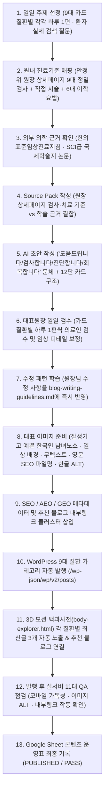
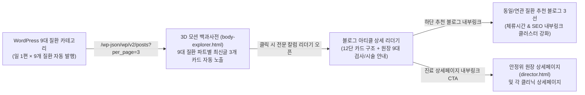

# 📋 바른한의원 대전본점 · 블로그 콘텐츠 운영 및 WordPress 자동화 마스터 기획안 (v2.0 확정본)

> **문서 목적**: 환자가 실제로 검색하는 질문을 출발점으로 삼아, **안정위 대표원장 상세페이지([director.html](file:///c:/Users/0508a/.gemini/antigravity/scratch/%EB%B0%94%EB%A5%B8%ED%95%9C%EC%9D%98%EC%9B%90%20%ED%99%88%ED%8E%98%EC%9D%B4%EC%A7%80/homepage/director.html))의 9대 정밀 검진 시스템과 대표원장 직접 시술 및 6대 한의학적 물리·이학요법(자기장·소노·핫팩·ICT·IR·극초단파)**을 기반으로, **9대 카드 질환별로 각각 하루 1편씩** 신뢰도 높은 임상 칼럼을 발행하고 **3D 모션 의학백과사전([body-explorer.html](file:///c:/Users/0508a/.gemini/antigravity/scratch/%EB%B0%94%EB%A5%B8%ED%95%9C%EC%9D%98%EC%9B%90%20%ED%99%88%ED%8E%98%EC%9D%B4%EC%A7%80/homepage/body-explorer.html))에 각 질환별 최신글 3개 자동 노출 및 추천 블로그 내부링크**로 연결하는 표준 운영 시스템을 정의합니다.

---

## 🔄 0. 기획안 수정 전(v1.0) vs 수정 후(v2.0) 핵심 변경사항 비교 요약

| 항목 구분 | 수정 전 기획안 (v1.0) | 수정 후 마스터 기획안 (v2.0 · 대표원장 지침 100% 반영) |
| :--- | :--- | :--- |
| **1.1 문체 기준** | “확인합니다 / 진찰합니다 / 시행합니다 / 치료합니다” | **“도움드립니다. 검사합니다. 진단합니다. 회복합니다.”** (4대 표준 종결 어미로 전 섹션 통일) |
| **1.1 핵심 내용** | 일반적인 문진·맥진·복진 위주 서술, 혈액검사 등 원내 미시행 간주 | **안정위 원장 카드 상세페이지([director.html](file:///c:/Users/0508a/.gemini/antigravity/scratch/%EB%B0%94%EB%A5%B8%ED%95%9C%EC%9D%98%EC%9B%90%20%ED%99%88%ED%8E%98%EC%9D%B4%EC%A7%80/homepage/director.html))에 수록된 9대 정밀 검사(초음파·체열진단·이비인후 내시경·사상체질·체지방·자율신경 HRV·내분비/간/당 수치·혈관/어혈 독소·성장판 검사) 및 원장 1:1 직접 시술** 중심 서술 |
| **1.2 검수 및 발행량** | 전체 통틀어 하루 1~2편 순환 작성·검수 | **9대 카드 질환별로 각각 하루 1편** (질환별 매일 1편씩, 일 총 9편 생성·검수·패턴 학습) |
| **1.3 대표 이미지** | 흰색 반팔티를 입은 평범한 체형의 성인 남녀, 일상 배경 | **잘생기고 예쁜 한국인 남녀노소**(소아·청년·중장년·시니어 맞춤), 따뜻한 일상 배경, **무텍스트**, **영문 SEO 파일명 & 정확한 한글 ALT** |
| **1.4 홈페이지 연결** | 각 진료분야 상세페이지에 최신글 3개 노출 | **3D 모션 백과사전([body-explorer.html](file:///c:/Users/0508a/.gemini/antigravity/scratch/%EB%B0%94%EB%A5%B8%ED%95%9C%EC%9D%98%EC%9B%90%20%ED%99%88%ED%8E%98%EC%9D%B4%EC%A7%80/homepage/body-explorer.html))에 각 질환별 최신글 3개 자동 노출 및 ‘추천 블로그’로 상호 내부링크 연결** |
| **2.1 한의학적 치료** | 수기 추나, 침·전침, 약침, 부항, 맞춤 한약, 황제공진단 | 기존 치료 + **자기장 · 소노(초음파) · 핫팩 · ICT(간섭파) · IR(적외선) · 극초단파** 6대 물리·이학요법 정식 추가 |
| **3.1 소화 파트 분리** | `소화 · 대사 다이어트`로 단일 통합 (8개 파트) | **소화 파트(`소화 · 위장 · 담적 해독`, `blog-digest`)를 별도 개별 파트로 분리 신설**하여 총 **9대 카드 질환 체제** 구축 |
| **3.2 자율신경 파트** | `자율신경 · 수면 · 실신` | **`자율신경 · 두통 · 어지럼 · 수면 · 실신`** (만성 두통·편두통·어지럼증 핵심 포함) |
| **3.3 소아성장 파트** | `소아 성장 · 면역` | **`소아 성장 · 소아비만 · 면역`** (소아비만·체지방 관리 및 성조숙증 예방 핵심 포함) |
| **3.4 전립선 파트** | `전립선 · 배뇨 · 남성활력` | **`전립선 · 요실금 · 남성활력`** (‘배뇨’를 구체적 질환명인 **‘요실금’**으로 전면 변경) |

---

## 1. 기존 시스템 진단 및 신규 표준 운영 시스템 (AS-IS vs TO-BE)

| 구분 | 기존 시스템 (AS-IS) | 신규 표준 운영 시스템 (TO-BE · v2.0 확정 기준) |
| :--- | :--- | :--- |
| **주제 선정** | 질환명·효능 설명 및 단편적 홍보 칼럼 | **환자가 실제 검색하는 증상·원인·비교 질문**에서 출발 (9대 카드 질환별 매일 발행) |
| **근거 관리** | AI가 일반 의학정보와 한의원 치료를 임의로 혼합 | **바른한의원 내부 실제 진료기준(원장 상세페이지 9대 검사·직접 시술·6대 이학요법)**과 **외부 SCI급 학술 근거**를 분리한 **Source Pack** 적용 |
| **1.1 문체 및 내용** | “검토합니다/고려합니다”, 원내 미시행 양방 검사 혼재 | **“도움드립니다. 검사합니다. 진단합니다. 회복합니다.”** 4대 명확 종결 문체 / **안정위 원장 카드 상세페이지([director.html](file:///c:/Users/0508a/.gemini/antigravity/scratch/%EB%B0%94%EB%A5%B8%ED%95%9C%EC%9D%98%EC%9B%90%20%ED%99%88%ED%8E%98%EC%9D%B4%EC%A7%80/homepage/director.html))에 있는 9대 정밀 검사 및 원장 직접 시술** 수록 |
| **1.2 검수 프로세스** | 무검수 일괄 자동 발행 또는 비정기 수동 작성 | **9대 카드 질환별로 각각 하루 1편** (일 총 9편) 생성 → **대표원장 검수·수정 → 수정 패턴을 기준 문서에 재학습** |
| **본문 디자인** | 긴 줄글 위주의 텍스트 덩어리 | **섹션별 카드·연한 배경·테두리**로 모바일·데스크톱 스크롤 시 한눈에 들어오는 의료 설명 레이아웃 |
| **1.3 대표 이미지** | 연출된 스튜디오 홍보물 또는 획일적 흰 반팔티 제한 | **잘생기고 예쁜 한국인 남녀노소**, 따뜻한 일상 배경, **무텍스트(글자 배제)**, **영문 SEO 파일명 & 정확한 한글 ALT** |
| **1.4 홈페이지 연결** | 5번째 탭 목록 내부에만 단순 나열 | **3D 모션 백과사전([body-explorer.html](file:///c:/Users/0508a/.gemini/antigravity/scratch/%EB%B0%94%EB%A5%B8%ED%95%9C%EC%9D%98%EC%9B%90%20%ED%99%88%ED%8E%98%EC%9D%B4%EC%A7%80/homepage/body-explorer.html))에 최신글 각 질환별로 3개 자동 노출** 및 본문·하단 **‘추천 블로그’로 내부링크 연결** |
| **품질 보증(QA)** | 발행 여부만 단순 확인 | 발행 전 8대 QA + **발행 후 실서버 11대 QA 체크리스트** 통과 후 운영표 기록 |

---

## 2. 시작 전에 준비할 5대 핵심 기반 (Foundation)

### ① 바른한의원 대전본점 실제 진료 기준 (`clinic-clinical-standards.json`)
AI가 추상적인 진료를 적지 않도록, **안정위 대표원장 상세페이지([director.html](file:///c:/Users/0508a/.gemini/antigravity/scratch/%EB%B0%94%EB%A5%B8%ED%95%9C%EC%9D%98%EC%9B%90%20%ED%99%88%ED%8E%98%EC%9D%B4%EC%A7%80/homepage/director.html))에 명시된 실제 정밀 검사와 대표원장 직접 시술 및 물리치료 장비**를 표준 기준으로 고정합니다.

#### A. 안정위 대표원장 직접 진찰 및 상세페이지 9대 정밀 검진 시스템 (`"검사합니다 / 진단합니다"`)
1. **대표원장 1:1 심층 진찰 (CARD 01~03)**:
   - 심층 문진(수면·소화·대소변·한열·스트레스·악화 자세 파악), **양 손목 정밀 진맥(창조한 眞장부맥학으로 오장육부와 자율신경 파동 판독)**, 복진(명치·배꼽·하복부 담적 및 압통 확인), 척추·골반·관절 가동범위(ROM) 및 체형 비대칭 이학적 검사로 **진단합니다**.
2. **[검진 01] 정밀 초음파 영상 검사 (통증 · 오장육부 | CARD 06)**:
   - 근육·인대·힘줄·관절의 심부 통증 부위부터 간·담낭·위장·방광 등 오장육부 내부 상태까지 방사선 노출 없이 실시간 초음파 영상으로 **검사합니다**.
3. **[검진 02] 적외선 체열진단기 검사 (DITI · 면역 · 순환 · 생식기능 | CARD 07)**:
   - 상체로 몰린 열독과 손발·하복부의 냉증을 체표 온도 분포로 시각화하여 면역 저하, 말초 혈액순환 정체, 자궁·전립선 등 생식기능 밸런스를 **검사합니다**.
4. **[검진 03] 이비인후 내시경 검사 (귀 · 코 · 목 | CARD 08)**:
   - 중이염 고막 상태, 비염·축농증으로 부어오른 비강 점막, 편도와 인후두 충혈까지 고화질 내시경으로 직접 관찰하여 호흡기·면역 질환의 뿌리를 **검사합니다**.
5. **[검진 04] 사상체질 정밀 검사 (맞춤 체질의학 | CARD 09)**:
   - 체형·성정·체질 분석과 대표원장의 정밀 맥진·복진을 결합하여 태양·태음·소양·소음 사상체질과 오장육부 대소(大小) 강약을 **진단합니다**.
6. **[검진 05] 체지방 · 체성분 정밀 검사 (InBody · 소아 및 복부비만 | CARD 10)**:
   - 체지방률, 복부 내장지방 레벨, 부위별 골격근량, 체수분·부종 밸런스를 정밀 계측하여 성장기 소아비만과 성인 복부비만을 과학적으로 **검사합니다**.
7. **[검진 06] 자율신경 · 스트레스 검사 (HRV · 두통 · 어지럼 · 불면 | CARD 11)**:
   - 심박변이도(HRV)와 자율신경 활성도를 측정해 교감신경 과열과 부교감신경 저하를 수치로 분석하고, 만성 두통·어지럼증·불면증·미주신경성 실신의 신경계 원인을 **진단합니다**.
8. **[검진 07] 내분비 · 간 및 당 수치 검사 (대사질환 & 안심 한약 | CARD 12)**:
   - 한약 복용 전후 간 기능 수치(AST·ALT)와 혈당·당화혈색소(HbA1c)·지질 대사 지표를 정밀하게 점검하여 대사질환을 관리하고 간 부담 없는 안전한 한약 처방을 **검사합니다**.
9. **[검진 08] 말초 혈관 상태 검사 (APG · 혈관 노화도 · 어혈 · 독소 | CARD 13)**:
   - 가속도 맥파로 혈관 탄성도와 말초 혈류 속도, 혈관 내 어혈·독소 정체 정도를 단계별로 분석하여 손발 저림·수족냉증·만성 피로를 **검사합니다**.
10. **[검진 09] 소아 · 청소년 성장 정밀 검사 (성장판 · 골연령 · 최종예상키 | CARD 14)**:
    - 무방사선 성장판 초음파와 뼈나이(골연령)·뼈길이 계측, 체형 불균형·성조숙증 징후를 종합 분석하여 아이의 숨은 키와 성장 골든타임을 **진단합니다**.

#### B. 실제 시행하는 한의학적 치료 — 대표원장 직접 시술 & 6대 물리·이학요법 (`"도움드립니다 / 회복합니다"`)
1. **안정위 대표원장 1:1 직접 시술**:
   - **대표원장 수기 추나요법**: 경추(거북목·일자목), 흉·요추 디스크·협착증, 골반·천장관절 비대칭 신경감압 추나 및 무통 소아 성장 추나를 원장이 직접 시술하여 구조적 균형을 **회복합니다**.
   - **침 · 전침 · 정제 약침 · 봉약침 · 부항 · 통비 시술**: 경혈 자극과 미세전류 전침, 염증·통증 부위 및 두피·자궁·전립선 표적 약침, 비강 점막 사혈·통비 치료로 손상된 조직 기능을 **회복합니다**.
2. **6대 한의학적 물리 · 이학요법 장비 (신규 필수 반영)**:
   - **자기장 치료 (심부 전자기장 치료 · PMS)**: 옷을 입은 상태에서도 고강도 펄스 전자기장이 근육·신경 뿌리·골반저 심부까지 깊숙이 침투하여 척추·관절 심부 통증 완화 및 전립선·요실금 골반저근 수축력 강화를 **도움드립니다**.
   - **소노 치료 (초음파 물리치료 · SONO)**: 세밀한 초음파 미세 진동 에너지로 굳어진 근막·인대·건의 유착을 풀고 성장판 및 관절 연부조직의 미세혈류와 조직 재생을 **도움드립니다**.
   - **핫팩 온열요법 (습식 온열 찜질 · Hot Pack)**: 경직된 표층·중층 근육과 복부·골반을 따뜻하게 데워 혈관을 확장하고 추나·침 치료 전후 긴장 이완을 **도움드립니다**.
   - **ICT 치료 (간섭파 전류치료 · Interferential Current Therapy)**: 서로 다른 중주파 전류를 교차 침투시켜 피부 저항 없이 심부 근육 경련을 풀고 통증 신경 전달을 억제하여 편안한 움직임을 **회복합니다**.
   - **IR 치료 (적외선 조사요법 · Infrared Therapy)**: 침·약침 시술 부위 및 냉증·통증 부위에 온열 적외선을 조사하여 국소 모세혈관 순환과 면역 세포 활성화를 **도움드립니다**.
   - **극초단파 치료 (심부 투열 치료 · Microwave Diathermy)**: 일반 온열기가 닿지 않는 척추관·고관절·하복부(자궁·전립선·위장) 깊은 조직 내부에 직접 생체 심부열을 발생시켜 만성 염증과 심부 냉증을 근본적으로 **회복합니다**.
3. **원내 직접 압력 탕전 맞춤 한약 & 특허 수제 황제공진단 (CARD 04~05)**:
   - 국가 유해성 검사를 통과한 식약처 인증 GAP·hGMP 청정 정품 한약재를 원내에서 직접 달여내며, SCI급 국제학술지 논문으로 간·신장 안전성과 치료 기전이 입증된 1:1 사상체질 맞춤 한약 및 식약처 CITES 인증 정품 사향·러시아산 녹용 분골 특허 황제공진단(특허 제10-1744704호)으로 전신 자생력을 **회복합니다**.

---

### ② 홈페이지 구조 및 9대 카드 질환 연결 매핑 (3.1 ~ 3.4 전면 반영)
기존 8대 분류에서 **‘소화’를 독립된 개별 파트로 신설**하고, **자율신경 파트에 ‘두통·어지럼’ 포함**, **소아성장 파트에 ‘소아비만’ 추가**, **전립선 파트의 배뇨를 ‘요실금’으로 변경**하여 총 **9대 카드 질환 체계**로 매핑합니다. 모든 블로그 글은 **3D 모션 백과사전([body-explorer.html](file:///c:/Users/0508a/.gemini/antigravity/scratch/%EB%B0%94%EB%A5%B8%ED%95%9C%EC%9D%98%EC%9B%90%20%ED%99%88%ED%8E%98%EC%9D%B4%EC%A7%80/homepage/body-explorer.html))에 각 질환별 최신글 3개가 자동 노출**되며 상호 추천 블로그 내부링크로 연결됩니다.

| 카드 번호 | 9대 카드 질환 파트명 (개편 확정) | 핵심 포괄 질환 및 증상 | 원장 상세페이지 연계 검사 & 시술 | 3D 모션 백과사전 최신글 3개 노출처 & 연결 상세페이지 | WP 카테고리 슬러그 |
| :---: | :--- | :--- | :--- | :--- | :--- |
| **1** | **통증 · 척추관절** | 허리디스크, 목디스크, 척추관협착증, 좌골신경통, 골반 틀어짐, 오십견·회전근개, 무릎·족저근막 통증 | **[검진 01] 통증 초음파**, **[검진 02] 체열진단(DITI)** + 원장 직접 수기 추나, 약침, **자기장·소노·핫팩·ICT·IR·극초단파** | [body-explorer.html?part=lumbar](file:///c:/Users/0508a/.gemini/antigravity/scratch/%EB%B0%94%EB%A5%B8%ED%95%9C%EC%9D%98%EC%9B%90%20%ED%99%88%ED%8E%98%EC%9D%B4%EC%A7%80/homepage/body-explorer.html) ↔ [chuna.html](file:///c:/Users/0508a/.gemini/antigravity/scratch/%EB%B0%94%EB%A5%B8%ED%95%9C%EC%9D%98%EC%9B%90%20%ED%99%88%ED%8E%98%EC%9D%B4%EC%A7%80/homepage/chuna.html) | `blog-lumbar` |
| **2** | **소화 · 위장 · 담적 해독** *(3.1 개별 파트 신설)* | 내시경 정상 만성 소화불량, 담적병, 역류성식도염, 명치 답답함·트림, 과민성장증후군, 만성 변비·설사 | **[검진 01] 오장육부 복부 초음파**, **[검진 02] 복부 체열진단**, **[검진 04] 사상체질·복진** + 내장기 추나, 복부 약침, **극초단파·자기장·IR·핫팩**, 보비위·담적 한약 | [body-explorer.html?part=digest](file:///c:/Users/0508a/.gemini/antigravity/scratch/%EB%B0%94%EB%A5%B8%ED%95%9C%EC%9D%98%EC%9B%90%20%ED%99%88%ED%8E%98%EC%9D%B4%EC%A7%80/homepage/body-explorer.html) ↔ [director.html](file:///c:/Users/0508a/.gemini/antigravity/scratch/%EB%B0%94%EB%A5%B8%ED%95%9C%EC%9D%98%EC%9B%90%20%ED%99%88%ED%8E%98%EC%9D%B4%EC%A7%80/homepage/director.html) | `blog-digest` |
| **3** | **대사 · 복부비만 다이어트** | 성인 복부·내장지방 비만, 나잇살, 산후·갱년기 비만, 부종형 비만, 식욕 조절(렙틴 저항성), 고지혈·대사증후군 | **[검진 05] 체지방·체성분 검사**, **[검진 07] 내분비·간(AST/ALT)·당 수치 검사**, **[검진 08] 어혈 독소 검사** + 식욕ZERO 대사 한약, 지방분해 전침, **자기장·소노·극초단파** | [body-explorer.html?part=gut](file:///c:/Users/0508a/.gemini/antigravity/scratch/%EB%B0%94%EB%A5%B8%ED%95%9C%EC%9D%98%EC%9B%90%20%ED%99%88%ED%8E%98%EC%9D%B4%EC%A7%80/homepage/body-explorer.html) ↔ [diet-zero.html](file:///c:/Users/0508a/.gemini/antigravity/scratch/%EB%B0%94%EB%A5%B8%ED%95%9C%EC%9D%98%EC%9B%90%20%ED%99%88%ED%8E%98%EC%9D%B4%EC%A7%80/homepage/diet-zero.html) | `blog-gut` |
| **4** | **자율신경 · 두통 · 어지럼 · 수면 · 실신** *(3.2 두통·어지럼 포함)* | **만성 두통·편두통, 어지럼증(이석증 후유증·기립성 현훈)**, 불면증·수면유지장애, 미주신경성 실신, 가슴 두근거림·공황·자율신경실조증 | **[검진 06] 자율신경·스트레스 검사(HRV)**, **[검진 08] 말초 혈관 검사**, **[검진 02] 체열진단** + 상부경추·흉곽 자율신경 추나, 약침, **자기장·소노·ICT·IR·핫팩**, 안신·수승화강 한약 | [body-explorer.html?part=syncope](file:///c:/Users/0508a/.gemini/antigravity/scratch/%EB%B0%94%EB%A5%B8%ED%95%9C%EC%9D%98%EC%9B%90%20%ED%99%88%ED%8E%98%EC%9D%B4%EC%A7%80/homepage/body-explorer.html) ↔ [director.html](file:///c:/Users/0508a/.gemini/antigravity/scratch/%EB%B0%94%EB%A5%B8%ED%95%9C%EC%9D%98%EC%9B%90%20%ED%99%88%ED%8E%98%EC%9D%B4%EC%A7%80/homepage/director.html) | `blog-syncope` |
| **5** | **소아 성장 · 소아비만 · 면역** *(3.3 소아비만 추가)* | 키 성장 부진, **소아비만·과체중 관리**, 성조숙증(조기 골화), 비염·축농증·구강호흡, 잦은 감기·중이염·편도염, 소아 체형 교정 | **[검진 09] 성장판 초음파·골연령·최종예상키 검사**, **[검진 05] 소아 체지방 검사**, **[검진 03] 이비인후 내시경(귀·코·목)** + 소아 성장 추나, 비강 통비 시술, **소노·자기장·IR**, 성장·소아비만 한약 | [body-explorer.html?part=knee](file:///c:/Users/0508a/.gemini/antigravity/scratch/%EB%B0%94%EB%A5%B8%ED%95%9C%EC%9D%98%EC%9B%90%20%ED%99%88%ED%8E%98%EC%9D%B4%EC%A7%80/homepage/body-explorer.html) ↔ [growth.html](file:///c:/Users/0508a/.gemini/antigravity/scratch/%EB%B0%94%EB%A5%B8%ED%95%9C%EC%9D%98%EC%9B%90%20%ED%99%88%ED%8E%98%EC%9D%B4%EC%A7%80/homepage/growth.html) | `blog-knee` |
| **6** | **여성 · 생리통 · 난임** | 극심한 생리통·생리불순, 자궁내막증·자궁근종 보존케어, 자연임신·시험관(IVF) 착상 준비, 습관성 유산 방지(안태), 산후풍·갱년기 | **[검진 02] 하복부·생식기 적외선 체열진단**, **[검진 01] 하복부 초음파**, **[검진 08] 어혈·혈관 검사** + 골반 교정 추나, 보궁 약침, **극초단파·자기장·IR·핫팩**, 보궁·착상·어혈 한약 | [body-explorer.html?part=uterus](file:///c:/Users/0508a/.gemini/antigravity/scratch/%EB%B0%94%EB%A5%B8%ED%95%9C%EC%9D%98%EC%9B%90%20%ED%99%88%ED%8E%98%EC%9D%B4%EC%A7%80/homepage/body-explorer.html) ↔ [director.html](file:///c:/Users/0508a/.gemini/antigravity/scratch/%EB%B0%94%EB%A5%B8%ED%95%9C%EC%9D%98%EC%9B%90%20%ED%99%88%ED%8E%98%EC%9D%B4%EC%A7%80/homepage/director.html) | `blog-uterus` |
| **7** | **탈모 · 두피 · 목어깨** | 정수리·M자 열성탈모, 원형탈모, 여성 가르마·산후 탈모, 지루성 두피염·모낭염, 동반 거북목·목어깨 결림 | **[검진 02] 두피·경추 적외선 체열진단**, 두피 현미경, **[검진 06] 자율신경 스트레스 검사** + 상부 경추 감압 추나, 모낭 재생 약침, **자기장·소노·ICT·IR·핫팩**, 수승화강 발모 한약 | [body-explorer.html?part=cervical](file:///c:/Users/0508a/.gemini/antigravity/scratch/%EB%B0%94%EB%A5%B8%ED%95%9C%EC%9D%98%EC%9B%90%20%ED%99%88%ED%8E%98%EC%9D%B4%EC%A7%80/homepage/body-explorer.html) ↔ [hairloss.html](file:///c:/Users/0508a/.gemini/antigravity/scratch/%EB%B0%94%EB%A5%B8%ED%95%9C%EC%9D%98%EC%9B%90%20%ED%99%88%ED%8E%98%EC%9D%B4%EC%A7%80/homepage/hairloss.html) (외 4대 유형) | `blog-cervical` |
| **8** | **전립선 · 요실금 · 남성활력** *(3.4 배뇨→요실금 변경)* | 전립선비대증, 만성 비세균성 전립선염(골반통), **복압성·절박성 요실금, 과민성 방광·야간뇨**, 남성 갱년기·성기능 활력 저하 | **[검진 01] 방광·하복부 초음파**, **[검진 02] 생식기 체열진단**, **[검진 08] 말초 혈관 탄성도 검사** + 골반저 추나, 회음 약침, **심부 자기장(골반저 강화)·극초단파·소노·ICT·IR·핫팩**, 보신·괄약근 한약 | [body-explorer.html?part=prostate](file:///c:/Users/0508a/.gemini/antigravity/scratch/%EB%B0%94%EB%A5%B8%ED%95%9C%EC%9D%98%EC%9B%90%20%ED%99%88%ED%8E%98%EC%9D%B4%EC%A7%80/homepage/body-explorer.html) ↔ [prostate.html](file:///c:/Users/0508a/.gemini/antigravity/scratch/%EB%B0%94%EB%A5%B8%ED%95%9C%EC%9D%98%EC%9B%90%20%ED%99%88%ED%8E%98%EC%9D%B4%EC%A7%80/homepage/prostate.html) | `blog-prostate` |
| **9** | **만성피로 · 황제공진단** | 만성피로증후군, 브레인 포그·기억력 감퇴, 번아웃, 수험생 두뇌 체력, 수술·큰 병 후 기력 회복, 중장년 심뇌혈관·항노화 | **[검진 08] 혈관 노화도·어혈 독소 검사**, **[검진 06] 자율신경 피로도 검사**, **[검진 07] 간·당 대사 검사**, **[검진 04] 사상체질·진맥** + 원장 직접 수제 제환 특허 황제공진단, 기혈 침·약침, **자기장·극초단파·IR·핫팩** | [body-explorer.html?part=gongjindan](file:///c:/Users/0508a/.gemini/antigravity/scratch/%EB%B0%94%EB%A5%B8%ED%95%9C%EC%9D%98%EC%9B%90%20%ED%99%88%ED%8E%98%EC%9D%B4%EC%A7%80/homepage/body-explorer.html) ↔ [gongjindan.html](file:///c:/Users/0508a/.gemini/antigravity/scratch/%EB%B0%94%EB%A5%B8%ED%95%9C%EC%9D%98%EC%9B%90%20%ED%99%88%ED%8E%98%EC%9D%B4%EC%A7%80/homepage/gongjindan.html) | `blog-gongjindan` |

---

### ③ 콘텐츠 운영표 (Google Sheet 14개 표준 컬럼 · 9대 질환 일일 발행 트래커)
**9대 카드 질환별로 각각 하루 1편(일 총 9편)** 발행·검수 현황을 정밀 추적하는 마스터 시트 구조입니다.

| 컬럼명 | 설명 및 예시 |
| :--- | :--- |
| `Content ID` | 날짜 + 질환코드 고유 식별자 (예: `BR-20261023-DIGEST-01`) |
| `카드 질환 파트 (1~9)` | 1.통증 / 2.소화(신설) / 3.대사다이어트 / 4.자율신경·두통·어지럼·수면·실신 / 5.소아성장·소아비만·면역 / 6.여성·난임 / 7.탈모·두피 / 8.전립선·요실금·남성활력 / 9.만성피로·공진단 |
| `3D 백과사전 노출 타깃` | `https://www.bareunhaniwon.com/body-explorer/?part=digest&tab=blog` (최신글 3개 자동 노출 슬롯) |
| `추천 블로그 내부링크` | 동일 파트 이전 발행 칼럼 2~3건 + 연관 클리닉 상세페이지(`director.html` 등) 링크 매핑 |
| `주제 (환자 검색 질문)` | 위내시경은 정상인데 식후 명치가 답답하고 신물이 올라오는 이유는 무엇인가요? |
| `연계 원장 상세 검사/시술` | [검진 01] 오장육부 복부 초음파 + [검진 02] 적외선 체열진단 + 원장 복진/내장기 추나 + 극초단파·자기장·핫팩 |
| `상태` | `DAILY_QUEUE` → `SOURCE_PACK` → `AI_DRAFT` → `DOCTOR_REVIEW` → `QA_READY` → `PUBLISHED` |
| `자료 출처` | 바른한의원 진료기준 v2.0 + 한의표준임상진료지침(기능성소화불량) + SCI급 리뷰 논문 |
| `대표 이미지 (파일명/ALT)` | `korean-woman-checking-epigastric-bloating-home.jpg` / `햇살 드는 거실 식탁에서 명치 부위 답답함을 살피는 단정한 한국인 여성` |
| `AI 초안 링크` | Google Docs 초안 문서 링크 |
| `대표원장 검수·수정본` | 안정위 대표원장 코멘트 및 수정 완료본 |
| `발행 URL` | 실제 발행된 WordPress 고유 주소 |
| `QA 결과` | `PASS` / `HOLD` (11대 실서버 검증 결과) |
| `수정 패턴 학습 메모` | 원장님 수정 사항 기록 → `blog-writing-guidelines.md` 즉시 반영 |

---

### ④ 글 작성 기준 문서 (`blog-writing-guidelines.md`)
- **4대 필수 종결 문체 원칙**:
  1. **`"~하도록 도움드립니다"`**: 환자의 일상 불편 공감, 생활 관리 가이드, 이학요법(자기장·소노·핫팩·ICT·IR·극초단파) 보조 시너지 설명 시 사용
  2. **`"~을 검사합니다"`**: 안정위 원장 상세페이지([director.html](file:///c:/Users/0508a/.gemini/antigravity/scratch/%EB%B0%94%EB%A5%B8%ED%95%9C%EC%9D%98%EC%9B%90%20%ED%99%88%ED%8E%98%EC%9D%B4%EC%A7%80/homepage/director.html))의 9대 정밀 검진 장비(초음파, 적외선 체열진단기, 이비인후 내시경, 사상체질, 체지방, 자율신경 HRV, 내분비·간·당 수치, 말초 혈관·어혈 독소, 소아 성장판 검사) 시행 과정 서술 시 사용
  3. **`"~을 진단합니다"`**: 안정위 대표원장의 1:1 심층 문진, 眞(진)장부맥학 양 손목 진맥, 복진, 이학적 가동범위 검사 및 정밀 검사 데이터 통합 판독 시 사용
  4. **`"~을 회복합니다"`**: 대표원장 직접 시술(수기 추나, 침·전침, 정제 약침, 비강 통비 시술)과 6대 물리치료 및 원내 직접 탕전 맞춤 한약·황제공진단을 통한 기능 정상화 서술 시 사용
- **금지 표현**: “검토합니다”, “고려합니다”, “기대할 수 있습니다” 같은 모호하고 수동적인 번역투 어미 배제 / 의료법상 금지된 “100% 완치 보장” 등 과장 표현 배제.

### ⑤ WordPress 자동 제어 연결 ([deploy-cafe24.js](file:///c:/Users/0508a/.gemini/antigravity/scratch/%EB%B0%94%EB%A5%B8%ED%95%9C%EC%9D%98%EC%9B%90%20%ED%99%88%ED%8E%98%EC%9D%B4%EC%A7%80/homepage/deploy-cafe24.js) & [google-apps-script-daily-blog.gs](file:///c:/Users/0508a/.gemini/antigravity/scratch/%EB%B0%94%EB%A5%B8%ED%95%9C%EC%9D%98%EC%9B%90%20%ED%99%88%ED%8E%98%EC%9D%B4%EC%A7%80/homepage/google-apps-script-daily-blog.gs))
카페24 워드프레스(`https://www.bareunhaniwon.com/`)의 9대 질환 카테고리(`blog-lumbar`, `blog-digest`, `blog-gut`, `blog-syncope`, `blog-knee`, `blog-uterus`, `blog-cervical`, `blog-prostate`, `blog-gongjindan`)로 **매일 각 질환별 1편씩(하루 총 9편)** REST API를 통해 발행하며, **3D 모션 백과사전([body-explorer.html](file:///c:/Users/0508a/.gemini/antigravity/scratch/%EB%B0%94%EB%A5%B8%ED%95%9C%EC%9D%98%EC%9B%90%20%ED%99%88%ED%8E%98%EC%9D%B4%EC%A7%80/homepage/body-explorer.html))에서 각 질환별 최신글 3개 자동 노출 및 추천 블로그 내부링크**가 실시간으로 동기화됩니다.

---

## 3. 전체 13단계 표준 작업 흐름 (Workflow Architecture)

---

## 4. 글 작성 구조 및 시각 디자인 표준 (12단 카드 레이아웃)

### 4-1. 환자 질문 중심 12단 본문 구조 (`도움드립니다 · 검사합니다 · 진단합니다 · 회복합니다` 적용)
‘질환명 사전적 정의’로 시작하지 않고, **환자가 검색창에 입력한 질문에 첫 2~4문장 안에 명확히 답하는 구조(AEO/GEO 최적화)**로 작성합니다.

1. **질문형 제목 (H1)**: 환자가 실제로 검색하는 구체적인 증상·비교 질문 (예: *기침이나 재채기할 때 자꾸 새는 요실금, 단순 노화일까 골반저근과 방광 냉증 문제일까?*)
2. **핵심만 먼저 (첫 2~4문장 즉답 카드)**: 질문에 대한 핵심 결론과 구분 기준을 첫 문단에서 명확히 제시하여 빠른 이해를 **도움드립니다**.
3. **H2 질문 1 — 왜 이런 증상이 생길 수 있나요?**: 해부학적·생리학적 원인과 한의학적 기전을 알기 쉽게 풀어 설명하고 SCI급 학술 논문 근거를 함께 제시하여 정확한 원인 파악을 **도움드립니다**.
4. **H2 질문 2 — 비슷한 다른 문제와는 어떻게 구분하나요?**: 헷갈리기 쉬운 유사 질환(예: 복압성 요실금 vs 절박성 요실금 / 경추성 손저림 vs 손목터널증후군 / 단순 복부비만 vs 담적병)을 2단 비교 카드로 명확히 구분해 **진단합니다**.
5. **H2 질문 3 — 일상에서 어떤 증상·움직임·상황을 보면 알 수 있나요?**: 환자 스스로 일상 속에서 점검해 볼 수 있는 구체적인 증상 체크리스트를 안내해 조기 발견을 **도움드립니다**.
6. **H2 질문 4 — 바른한의원에서는 어떤 정밀 장비와 진찰로 원인을 찾나요? (`"검사합니다 / 진단합니다"`)**:
   - **안정위 대표원장 상세페이지([director.html](file:///c:/Users/0508a/.gemini/antigravity/scratch/%EB%B0%94%EB%A5%B8%ED%95%9C%EC%9D%98%EC%9B%90%20%ED%99%88%ED%8E%98%EC%9D%B4%EC%A7%80/homepage/director.html))의 9대 정밀 검진 시스템** 중 해당 질환에 맞는 핵심 검사(**정밀 초음파 검사, 적외선 체열진단기 DITI, 이비인후 내시경, 사상체질 검사, 체지방·체성분 검사, 자율신경 HRV 검사, 내분비·간·당 수치 검사, 말초 혈관·어혈 독소 검사, 소아 성장판 검사**)로 정밀하게 **검사합니다**.
   - 이어서 안정위 대표원장이 직접 1:1 심층 문진과 **眞(진)장부맥학 양 손목 진맥**, 복진, 체형·관절 가동범위 평가를 결합하여 보이지 않는 병의 뿌리를 입체적으로 **진단합니다**.
7. **H2 질문 5 — 어떤 원장 직접 시술과 한의학적 물리·한약 치료로 다스리나요? (`"도움드립니다 / 회복합니다"`)**:
   - **안정위 대표원장 직접 시술**: 원장 1:1 수기 추나요법, 침·전침, 정제 약침·봉약침, 부항, 비강 통비 시술을 직접 시행하여 틀어진 구조와 신경 압박을 **회복합니다**.
   - **6대 한의학적 물리·이학요법 병행**: 증상 부위와 심부 조직 상태에 맞춰 **자기장(심부 전자기장) · 소노(초음파 물리치료) · 핫팩(습식 온열) · ICT(간섭파 전류치료) · IR(적외선 치료) · 극초단파(심부 투열 치료)**를 체계적으로 병행하여 통증 완화와 심부 혈류 개선을 **도움드립니다**.
   - **원내 직접 탕전 맞춤 한약 & 황제공진단**: 간·신장 안전성이 입증된 사상체질 맞춤 한약과 정품 사향 황제공진단으로 오장육부 자생력을 근본부터 **회복합니다**.
8. **주의할 증상 (안전 정보 · Red Flag 박스)**: 지체 없이 정밀 감별이 필요한 위험 신호를 차분하고 객관적으로 안내하여 안전한 치료 결정을 **도움드립니다**.
9. **자주 묻는 질문 (FAQ · 3~4문항)**: 진료실에서 환자들이 가장 자주 묻는 실제 질문을 Q&A 카드로 정리하여 궁금증 해소를 **도움드립니다**.
10. **함께 읽으면 좋은 추천 블로그 & 3D 모션 백과사전 내부링크 (`1.4 핵심 반영`)**:
    - 동일 질환 카테고리의 **추천 블로그 칼럼 2~3편 내부링크 카드**를 배치하여 심화 학습을 **도움드립니다**.
    - **3D 모션 의학백과사전 해당 부위([body-explorer.html](file:///c:/Users/0508a/.gemini/antigravity/scratch/%EB%B0%94%EB%A5%B8%ED%95%9C%EC%9D%98%EC%9B%90%20%ED%99%88%ED%8E%98%EC%9D%B4%EC%A7%80/homepage/body-explorer.html))** 및 **해당 진료분야 상세페이지([director.html](file:///c:/Users/0508a/.gemini/antigravity/scratch/%EB%B0%94%EB%A5%B8%ED%95%9C%EC%9D%98%EC%9B%90%20%ED%99%88%ED%8E%98%EC%9D%B4%EC%A7%80/homepage/director.html), [chuna.html](file:///c:/Users/0508a/.gemini/antigravity/scratch/%EB%B0%94%EB%A5%B8%ED%95%9C%EC%9D%98%EC%9B%90%20%ED%99%88%ED%8E%98%EC%9D%B4%EC%A7%80/homepage/chuna.html) 등)**로 즉시 이동할 수 있는 양방향 내부링크 CTA 카드를 제공합니다.
11. **참고자료 (References)**: 한의표준임상진료지침, SCI급 국제 학술지 논문 등 명확한 의학 출처를 표기합니다.
12. **작성자 및 검토일 바이라인**: `작성 및 의학 검토: 바른한의원 대전본점 안정위 대표원장 | 최종 검토일: YYYY-MM-DD`

---

## 5. 대표 이미지 제작 및 이미지 SEO 기준 (1.3 전면 반영)

1. **인물 및 배경 연출 기준 (잘생기고 예쁜 한국인 남녀노소 · 일상 배경)**:
   - **인물**: 브랜드의 품격과 신뢰감을 높이는 **잘생기고 예쁜 한국인 남녀노소**로 구성합니다.
     - *소아 성장·소아비만·면역*: 밝고 사랑스러운 한국인 어린이·청소년과 따뜻하게 돌보는 젊은 한국인 부모
     - *통증·소화·다이어트·자율신경·여성·탈모*: 세련되고 호감형인 20~40대 한국인 성인 남녀
     - *전립선·요실금·만성피로·황제공진단*: 기품 있고 건강미 넘치는 40~60대 한국인 중장년·시니어 남녀
   - **표정 및 자세**: 기괴하거나 과장된 고통 표정을 배제하고, 일상 속에서 증상 부위(손목, 명치, 복부, 관자놀이, 뒷목, 허리, 무릎 등)를 자연스럽게 짚거나 살피는 품격 있는 에디토리얼 포즈로 연출합니다.
   - **배경 및 색감**: 햇살이 부드럽게 들어오는 거실, 침실, 다이닝룸, 서재, 세련된 오피스 등 **실제 한국인의 따뜻한 일상 공간**을 배경으로 하며, AI 특유의 차갑거나 플라스틱 같은 질감을 배제한 **따뜻하고 긍정적인 자연광 필름 색감**을 유지합니다.
   - **무텍스트 원칙 (No-Text)**: 이미지 내부에 한글·영문 텍스트, 간판, 워터마크를 일절 넣지 않아 글자 깨짐을 100% 원천 차단합니다.
2. **이미지 SEO 필수 규격**:
   - **영문 SEO 파일명**: 질환 핵심 키워드와 상황을 하이픈(`-`)으로 연결한 영문 소문자 파일명 사용
     - 예: `korean-woman-epigastric-indigestion-relief.jpg`, `korean-boy-growth-plate-knee-obesity-care.jpg`, `korean-man-autonomic-headache-dizziness-check.jpg`
   - **정확한 한글 ALT 텍스트**: 시각장애인 스크린리더와 검색엔진(Google/Naver 이미지 검색)이 이미지의 의학적 맥락을 정확히 파악하도록 인물·배경·증상 동작을 구체적인 한글 문장으로 기입
     - 예: `따뜻한 햇살이 비치는 거실 식탁에서 식후 명치 답답함과 소화불량을 살피는 단정한 한국인 여성`

---

## 6. 9대 카드 질환별 일일 발행 주제 큐 및 이미지·검사·시술 매핑 예시

**9대 카드 질환별로 각각 하루 1편씩** 발행할 때 적용되는 표준 매핑 예시입니다.

| 카드 질환 파트 | 연결 페이지 & 3D 백과사전 | 환자 실제 검색 질문 (블로그 제목 안) | 원장 상세페이지 검사 & 직접 시술 · 6대 물리치료 | 대표 이미지 파일명 & 한글 ALT (잘생기고 예쁜 한국인 남녀노소) |
| :--- | :--- | :--- | :--- | :--- |
| **1. 통증 · 척추관절** (`blog-lumbar`) | [body-explorer.html?part=lumbar](file:///c:/Users/0508a/.gemini/antigravity/scratch/%EB%B0%94%EB%A5%B8%ED%95%9C%EC%9D%98%EC%9B%90%20%ED%99%88%ED%8E%98%EC%9D%B4%EC%A7%80/homepage/body-explorer.html) ↔ [chuna.html](file:///c:/Users/0508a/.gemini/antigravity/scratch/%EB%B0%94%EB%A5%B8%ED%95%9C%EC%9D%98%EC%9B%90%20%ED%99%88%ED%8E%98%EC%9D%B4%EC%A7%80/homepage/chuna.html) | **엉덩이부터 종아리까지 당기고 저릴 때, 허리디스크와 이상근증후군은 어떻게 구분하고 회복하나요?** | **[검진 01] 통증 초음파** · **[검진 02] 체열진단**으로 검사·진단 → 원장 직접 수기 감압 추나 · 약침 + **심부 자기장 · 소노 · 극초단파 · ICT · IR · 핫팩**으로 회복 | `korean-man-lower-back-sciatica-pelvic-check.jpg` ALT: `밝은 서재 의자에서 일어나며 허리와 골반 뒤쪽 저림 부위를 살피는 잘생긴 한국인 남성` |
| **2. 소화 · 위장 · 담적 해독** (`blog-digest`) **[신설]** | [body-explorer.html?part=digest](file:///c:/Users/0508a/.gemini/antigravity/scratch/%EB%B0%94%EB%A5%B8%ED%95%9C%EC%9D%98%EC%9B%90%20%ED%99%88%ED%8E%98%EC%9D%B4%EC%A7%80/homepage/body-explorer.html) ↔ [director.html](file:///c:/Users/0508a/.gemini/antigravity/scratch/%EB%B0%94%EB%A5%B8%ED%95%9C%EC%9D%98%EC%9B%90%20%ED%99%88%ED%8E%98%EC%9D%B4%EC%A7%80/homepage/director.html) | **위내시경은 정상인데 식후 명치가 딱딱하게 막히고 트림·역류가 반복되는 담적병은 어떻게 진단하나요?** | **[검진 01] 오장육부 복부 초음파** · **[검진 02] 적외선 체열진단** · **[검진 04] 사상체질·복진**으로 진단 → 내장기 추나 · 복부 약침 + **극초단파 · 자기장 · IR · 핫팩** · 담적 해독 한약으로 회복 | `korean-woman-epigastric-fullness-digestion-home.jpg` ALT: `햇살 드는 다이닝룸 식탁에서 따뜻한 차를 앞에 두고 명치 부위를 부드럽게 살피는 예쁜 한국인 여성` |
| **3. 대사 · 복부비만 다이어트** (`blog-gut`) | [body-explorer.html?part=gut](file:///c:/Users/0508a/.gemini/antigravity/scratch/%EB%B0%94%EB%A5%B8%ED%95%9C%EC%9D%98%EC%9B%90%20%ED%99%88%ED%8E%98%EC%9D%B4%EC%A7%80/homepage/body-explorer.html) ↔ [diet-zero.html](file:///c:/Users/0508a/.gemini/antigravity/scratch/%EB%B0%94%EB%A5%B8%ED%95%9C%EC%9D%98%EC%9B%90%20%ED%99%88%ED%8E%98%EC%9D%B4%EC%A7%80/homepage/diet-zero.html) | **적게 먹어도 아랫배 내장지방만 찌는 대사 저하형 복부비만, 간 수치 부담 없이 건강하게 감량하는 법** | **[검진 05] 체지방·내장지방 검사** · **[검진 07] 내분비·간(AST/ALT)·당 수치 검사** · **[검진 08] 어혈 독소 검사**로 진단 → 원장 맥진 식욕ZERO 한약 + 지방분해 전침 · **자기장 · 소노 · 극초단파**로 회복 | `korean-woman-waistline-metabolic-diet-morning.jpg` ALT: `아침 햇살이 비치는 침실 거울 앞에서 복부 라인과 컨디션을 밝은 표정으로 점검하는 예쁜 한국인 여성` |
| **4. 자율신경 · 두통 · 어지럼 · 수면 · 실신** (`blog-syncope`) | [body-explorer.html?part=syncope](file:///c:/Users/0508a/.gemini/antigravity/scratch/%EB%B0%94%EB%A5%B8%ED%95%9C%EC%9D%98%EC%9B%90%20%ED%99%88%ED%8E%98%EC%9D%B4%EC%A7%80/homepage/body-explorer.html) ↔ [director.html](file:///c:/Users/0508a/.gemini/antigravity/scratch/%EB%B0%94%EB%A5%B8%ED%95%9C%EC%9D%98%EC%9B%90%20%ED%99%88%ED%8E%98%EC%9D%B4%EC%A7%80/homepage/director.html) | **MRI는 정상인데 지끈거리는 만성 두통과 어지럼증·불면증·실신이 함께 나타나는 자율신경 불균형 치료법** | **[검진 06] 자율신경·스트레스 검사(HRV)** · **[검진 08] 말초 혈관 상태 검사** · **[검진 02] 체열진단**으로 진단 → 상부경추 추나 · 약침 + **자기장 · 소노 · ICT · IR · 핫팩** · 안신 한약으로 회복 | `korean-woman-chronic-headache-dizziness-rest.jpg` ALT: `창가 소파에 앉아 관자놀이와 뒷목을 가볍게 짚으며 두통과 어지럼증을 달래는 단정한 한국인 여성` |
| **5. 소아 성장 · 소아비만 · 면역** (`blog-knee`) | [body-explorer.html?part=knee](file:///c:/Users/0508a/.gemini/antigravity/scratch/%EB%B0%94%EB%A5%B8%ED%95%9C%EC%9D%98%EC%9B%90%20%ED%99%88%ED%8E%98%EC%9D%B4%EC%A7%80/homepage/body-explorer.html) ↔ [growth.html](file:///c:/Users/0508a/.gemini/antigravity/scratch/%EB%B0%94%EB%A5%B8%ED%95%9C%EC%9D%98%EC%9B%90%20%ED%99%88%ED%8E%98%EC%9D%B4%EC%A7%80/homepage/growth.html) | **살이 급격히 찐 소아비만 아이와 비염 구강호흡 아이, 왜 성장판이 빨리 닫히고 키 성장이 멈출까요?** | **[검진 09] 성장판 초음파·골연령·최종예상키 검사** · **[검진 05] 소아 체지방 검사** · **[검진 03] 이비인후 내시경(귀·코·목)**으로 진단 → 소아 성장 추나 · 통비 시술 + **소노 · 자기장 · IR** · 소아비만·성장 한약으로 회복 | `korean-child-growth-check-with-mother-home.jpg` ALT: `따뜻한 거실에서 밝게 웃는 예쁜 한국인 어린이의 키와 체형을 엄마가 다정하게 살펴보는 일상 모습` |
| **6. 여성 · 생리통 · 난임** (`blog-uterus`) | [body-explorer.html?part=uterus](file:///c:/Users/0508a/.gemini/antigravity/scratch/%EB%B0%94%EB%A5%B8%ED%95%9C%EC%9D%98%EC%9B%90%20%ED%99%88%ED%8E%98%EC%9D%B4%EC%A7%80/homepage/body-explorer.html) ↔ [director.html](file:///c:/Users/0508a/.gemini/antigravity/scratch/%EB%B0%94%EB%A5%B8%ED%95%9C%EC%9D%98%EC%9B%90%20%ED%99%88%ED%8E%98%EC%9D%B4%EC%A7%80/homepage/director.html) | **진통제로도 안 듣는 극심한 생리통과 차가운 아랫배, 자궁 어혈 해독과 착상 내막을 튼튼히 회복하는 법** | **[검진 02] 생식기·하복부 적외선 체열진단** · **[검진 01] 하복부 초음파** · **[검진 08] 어혈 독소 검사**로 진단 → 골반 교정 추나 · 보궁 약침 + **극초단파 · 자기장 · IR · 핫팩** · 보궁 착상 한약으로 회복 | `korean-woman-warm-tea-lower-abdomen-care.jpg` ALT: `포근한 침실 소파에서 따뜻한 담요를 덮고 아랫배를 온화하게 감싸고 있는 예쁜 한국인 여성` |
| **7. 탈모 · 두피 · 목어깨** (`blog-cervical`) | [body-explorer.html?part=cervical](file:///c:/Users/0508a/.gemini/antigravity/scratch/%EB%B0%94%EB%A5%B8%ED%95%9C%EC%9D%98%EC%9B%90%20%ED%99%88%ED%8E%98%EC%9D%B4%EC%A7%80/homepage/body-explorer.html) ↔ [hairloss.html](file:///c:/Users/0508a/.gemini/antigravity/scratch/%EB%B0%94%EB%A5%B8%ED%95%9C%EC%9D%98%EC%9B%90%20%ED%99%88%ED%8E%98%EC%9D%B4%EC%A7%80/homepage/hairloss.html) | **정수리가 뜨겁고 모발이 가늘어질 때, 왜 두피 열독과 굳어진 거북목(경추)을 동시에 치료해야 할까요?** | **[검진 02] 두피·경추 적외선 체열진단** · **[검진 06] 자율신경 검사**로 진단 → 원장 직접 상부경추 감압 추나 · 모낭 재생 약침 + **자기장 · 소노 · ICT · IR · 핫팩** · 수승화강 발모 한약으로 회복 | `korean-man-checking-hairline-neck-mirror.jpg` ALT: `자연광이 드는 드레스룸 거울 앞에서 정수리 모발과 뒷목 라인을 살피는 세련된 한국인 남성` |
| **8. 전립선 · 요실금 · 남성활력** (`blog-prostate`) | [body-explorer.html?part=prostate](file:///c:/Users/0508a/.gemini/antigravity/scratch/%EB%B0%94%EB%A5%B8%ED%95%9C%EC%9D%98%EC%9B%90%20%ED%99%88%ED%8E%98%EC%9D%B4%EC%A7%80/homepage/body-explorer.html) ↔ [prostate.html](file:///c:/Users/0508a/.gemini/antigravity/scratch/%EB%B0%94%EB%A5%B8%ED%95%9C%EC%9D%98%EC%9B%90%20%ED%99%88%ED%8E%98%EC%9D%B4%EC%A7%80/homepage/prostate.html) | **새벽마다 깨는 야간뇨와 기침할 때 새는 요실금·전립선 불쾌감, 방광 괄약근과 골반저근을 깨우는 한방 치료** | **[검진 01] 방광·하복부 초음파** · **[검진 02] 생식기능 체열진단** · **[검진 08] 말초 혈관 검사**로 진단 → 골반저 추나 · 약침 + **심부 자기장(요실금·골반저 강화) · 극초단파 · 소노 · ICT · IR · 핫팩** · 보신 한약으로 회복 | `korean-middle-aged-couple-healthy-morning-livingroom.jpg` ALT: `여유로운 아침 거실에서 따뜻한 물을 마시며 활기차게 대화하는 품격 있는 한국인 중장년 부부` |
| **9. 만성피로 · 황제공진단** (`blog-gongjindan`) | [body-explorer.html?part=gongjindan](file:///c:/Users/0508a/.gemini/antigravity/scratch/%EB%B0%94%EB%A5%B8%ED%95%9C%EC%9D%98%EC%9B%90%20%ED%99%88%ED%8E%98%EC%9D%B4%EC%A7%80/homepage/body-explorer.html) ↔ [gongjindan.html](file:///c:/Users/0508a/.gemini/antigravity/scratch/%EB%B0%94%EB%A5%B8%ED%95%9C%EC%9D%98%EC%9B%90%20%ED%99%88%ED%8E%98%EC%9D%B4%EC%A7%80/homepage/gongjindan.html) | **자도 자도 무거운 만성피로와 브레인 포그, 정품 사향 특허 황제공진단이 뇌·심장 기혈을 깨우는 원리** | **[검진 08] 혈관 노화도·어혈 독소 검사** · **[검진 06] 자율신경 검사** · **[검진 07] 간·당 수치 검사** · **眞장부맥학 진맥**으로 진단 → 원장 직접 수제 특허 황제공진단 + **자기장 · 극초단파 · IR · 핫팩**으로 회복 | `korean-senior-couple-vitality-morning-sunlight.jpg` ALT: `따뜻한 아침 햇살이 가득한 거실에서 건강하고 환한 미소를 짓고 있는 품격 있는 한국인 시니어 부부` |

---

## 7. 홈페이지 3D 모션 백과사전 최신글 3개 자동 노출 및 추천 블로그 내부링크 설계 (1.4 핵심 반영)

블로그 글이 발행되면 **3D 모션 의학백과사전([body-explorer.html](file:///c:/Users/0508a/.gemini/antigravity/scratch/%EB%B0%94%EB%A5%B8%ED%95%9C%EC%9D%98%EC%9B%90%20%ED%99%88%ED%8E%98%EC%9D%B4%EC%A7%80/homepage/body-explorer.html)) 내 9대 카드 질환 파트마다 최신 글 3개가 자동 노출**되고, 각 글에서 **추천 블로그들로 내부링크가 유기적으로 연결**되도록 설계합니다.

1. **3D 모션 백과사전([body-explorer.html](file:///c:/Users/0508a/.gemini/antigravity/scratch/%EB%B0%94%EB%A5%B8%ED%95%9C%EC%9D%98%EC%9B%90%20%ED%99%88%ED%8E%98%EC%9D%B4%EC%A7%80/homepage/body-explorer.html)) 내 질환별 최신글 3개 자동 노출**:
   - 사용자가 3D 인체모형에서 9대 부위(`무릎·소아성장·소아비만`, `경추·탈모`, `요추·통증추나`, `뇌·심장·공진단`, `자율신경·두통·어지럼·수면·실신`, `소화·위장·담적`, `대사·복부비만 다이어트`, `자궁·난임`, `전립선·요실금·남성활력`) 중 어느 부위를 클릭하든, **의학백과 슬라이드 하단 및 질환별 블로그 탭 상단에 해당 질환의 최신 발행 글 3개가 카드 그리드로 즉시 자동 노출**됩니다.
   - WordPress에 새 글이 발행되면 코드 수정 없이도 REST API 실시간 동기화를 통해 최신글 3개 슬롯이 자동으로 갱신됩니다.
2. **추천 블로그 내부링크 연결 (Internal Link Cluster)**:
   - 개별 블로그 칼럼을 읽을 때 본문 하단에 **🔗 [함께 읽으면 좋은 추천 블로그]** 섹션이 자동 생성되어, 같은 질환 카테고리의 연관 칼럼들 및 인접 질환 칼럼으로 1클릭 이동할 수 있도록 내부링크를 촘촘히 연결합니다.
   - 또한 칼럼 내에서 언급된 정밀 검사(초음파, 체열진단, 자율신경 HRV 등) 및 시술은 **[안정위 대표원장 상세페이지 (`director.html`)](file:///c:/Users/0508a/.gemini/antigravity/scratch/%EB%B0%94%EB%A5%B8%ED%95%9C%EC%9D%98%EC%9B%90%20%ED%99%88%ED%8E%98%EC%9D%B4%EC%A7%80/homepage/director.html)** 및 해당 클리닉 상세페이지로 연결되어 검색 유입 환자의 실제 내원 상담 전환율을 극대화합니다.

---

## 8. 발행 전·후 품질 보증(QA) 19대 체크리스트

### 8-1. 발행 전 8대 필수 검수 (Pre-Publish QA)
1. **문체 준수**: 모든 진단·검사·치료·안내 문장이 **“도움드립니다 / 검사합니다 / 진단합니다 / 회복합니다”** 4대 표준 어미로 명확히 서술되었는가? (“검토합니다/고려합니다” 등 모호한 표현 0건)
2. **원장 상세페이지 정합성**: [director.html](file:///c:/Users/0508a/.gemini/antigravity/scratch/%EB%B0%94%EB%A5%B8%ED%95%9C%EC%9D%98%EC%9B%90%20%ED%99%88%ED%8E%98%EC%9D%B4%EC%A7%80/homepage/director.html)의 **9대 정밀 검진 항목**과 **안정위 원장 직접 시술** 내용이 정확히 반영되었는가?
3. **6대 물리·이학요법 반영**: 해당 질환 치료 프로토콜에 **자기장 · 소노 · 핫팩 · ICT · IR · 극초단파** 중 적합한 원내 치료가 구체적으로 안내되었는가?
4. **첫 문단 즉답(AEO)**: 첫 2~4문장 안에 환자의 검색 질문에 대한 핵심 결론이 제시되었는가?
5. **시각 카드 분리**: 긴 줄글 덩어리 없이 요약 박스, 비교 그리드, 검사·치료 프로세스 카드로 가독성 있게 구분되었는가?
6. **대표 이미지 규격**: **잘생기고 예쁜 한국인 남녀노소 + 일상 배경 + 무텍스트(글자 깨짐 없음)** 기준을 충족하는가?
7. **이미지 SEO**: **영문 키워드 파일명**(`*.jpg`)과 **구체적인 한글 ALT 텍스트**가 모두 입력되었는가?
8. **9대 질환 분류 정확성**: 새로 세분화된 9대 카드 질환(특히 **소화 개별 파트 분리**, **자율신경 내 두통·어지럼 포함**, **소아성장 내 소아비만 추가**, **전립선 내 요실금 변경**)에 정확히 매핑되었는가?

### 8-2. 발행 후 실서버 11대 점검 (Post-Publish Live QA)
1. WordPress 실서버 고유 URL 접속 시 200 OK 정상 렌더링 확인
2. 모바일 화면에서 카드 여백·줄바꿈·표 깨짐 없음 확인
3. 대표 이미지 정상 노출 및 한글 텍스트 깨짐 없음 확인
4. 이미지 `alt` 속성 및 영문 파일명 소스코드 반영 확인
5. SEO Title / Meta Description / Canonical 태그 정상 출력 확인
6. JSON-LD 구조화 데이터(`MedicalWebPage`, `FAQPage`, `Article`) 문법 오류 0건 확인
7. **3D 모션 백과사전([body-explorer.html](file:///c:/Users/0508a/.gemini/antigravity/scratch/%EB%B0%94%EB%A5%B8%ED%95%9C%EC%9D%98%EC%9B%90%20%ED%99%88%ED%8E%98%EC%9D%B4%EC%A7%80/homepage/body-explorer.html)) 해당 질환 파트에서 최신글 3개 자동 노출 슬롯**에 즉시 반영되었는지 확인
8. 칼럼 본문 하단 **‘추천 블로그’ 내부링크** 클릭 시 연관 칼럼으로 정상 이동 확인
9. 칼럼 내 **클리닉 상세페이지([director.html](file:///c:/Users/0508a/.gemini/antigravity/scratch/%EB%B0%94%EB%A5%B8%ED%95%9C%EC%9D%98%EC%9B%90%20%ED%99%88%ED%8E%98%EC%9D%B4%EC%A7%80/homepage/director.html) 등) 내부링크 CTA** 정상 이동 확인
10. 작성자(`바른한의원 대전본점 안정위 대표원장`) 및 최종 검토일 정상 표시 확인
11. Google Sheet 운영표에 `PUBLISHED` 및 `QA: PASS` 최종 기록 완료
