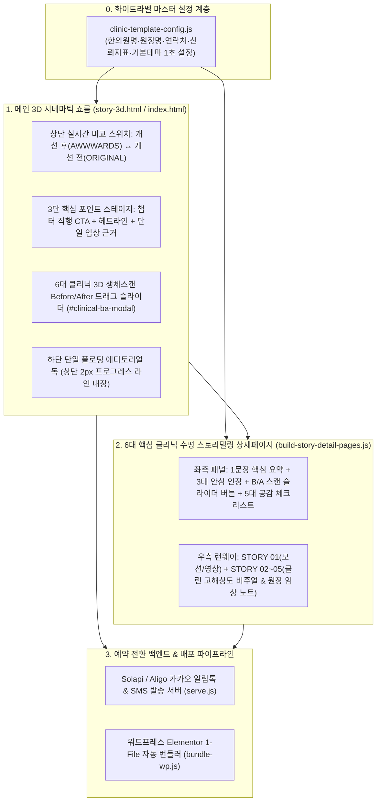

# 🏛️ 하이엔드 한의원 홈페이지 B2B 템플릿화 마스터 기획서 & 전·후(Before/After) 비교 리포트
**프로젝트명**: `BAREUN SIGNATURE EDITION — Awwwards-Grade Korean Medicine Web Template`  
**디자인 레퍼런스**: *Neko Health (14islands / Bedow)* · *Prenuvo* · *Lusion.co* · *Aesop*  
**핵심 철학**: **"불필요한 장식과 소음은 모두 덜어내고(Restraint Over Decoration), 원장님에게는 압도적 시각적 자부심을, 환자에게는 단 1초 만에 인지되는 전·후 치료 근거와 신뢰를 제공한다."**

---

## 1. 홈페이지 개선 전(Before) vs 개선 후(After) 핵심 차이 비교

화면 상단 좌측의 **`[개선 후 · AWWWARDS]` ↔ `[개선 전 · ORIGINAL]`** 실시간 비교 스위치를 클릭하면 브라우저에서 즉시 체감하실 수 있으며, 핵심 변경점은 아래와 같습니다.

| 비교 항목 | 개선 전 (ORIGINAL · 이전 상태) | 개선 후 (AWWWARDS EDITION · 현재 완료 상태) |
| :--- | :--- | :--- |
| **시각적 위계 & 클러터 제거** | • 버튼마다 이모지(`🛡️`, `💎`, `👁️`, `🔊`, `✦`)가 혼재되어 하이엔드 의료 브랜드의 무게감을 저해함<br/>• 화면 하단에 타임라인 바와 퀵독 2개가 겹쳐 시선이 분산됨<br/>• 상세페이지 좌측 패널에 긴 문단 2개 + 부연설명이 나열되어 스크롤 압박 발생 | ✅ **모든 이모지 완전 삭제** 및 절제된 에디토리얼 타이포그래피·헤어라인 보더 적용<br/>✅ 하단 2개 바를 **단 하나의 플로팅 독(`#awwwards-quick-dock` + 상단 2px 골드 프로그레스 라인)**으로 통합<br/>✅ 상세페이지 좌측 설명문을 **핵심 1문장 + 3대 수치 인장**으로 압축하여 한눈에 인지 |
| **치료 전·후(B/A) 시각적 증명** | • 텍스트와 단일 스토리 이미지만 존재하여, 환자와 원장님이 **"치료 전과 치료 후가 어떻게 달라지는지"** 직관적으로 비교할 도구가 없었음 | ✅ *Neko Health / Prenuvo* 스타일 **6대 클리닉 3D 바이오메디컬 Before/After 스캔 비주얼 12종 신규 생성**<br/>✅ 메인 쇼룸 및 6대 상세페이지 전체에 **드래그형 `B/A 전후 스캔 비교 ⇄` 스플릿 슬라이더** 탑재 |
| **메인 3D 스테이지 핵심 포인트 인지** | • 배경 위 짧은 대사 한 줄만 떠 있어 현재 어떤 클리닉 챕터인지, 어떤 임상 근거가 있는지 알 수 없었음 | ✅ **3단 핵심 포인트 구조**로 정제:<br/>① `챕터 번호` + `클리닉 상세보기 →` + `B/A 전후 스캔 비교 ⇄`<br/>② 고대비 메인 헤드라인 (`#dialogue-main-quote`)<br/>③ 단일 핵심 임상 근거 필 (`#dialogue-trust-pill`) |
| **시안성 모드 & 화이트라벨 데모** | • 다크 모드 고정으로 중장년층 가독성 옵션 및 타 한의원 상호 즉시 변환 시연 기능 부재 | ✅ **3단 시안성 프리셋** (`로얄 다크` / `온기 한지 라이트` / `초고시안성 큰글씨`)<br/>✅ **1초 화이트라벨 브랜드 변환기** (`[data-tpl]` 전체 실시간 연동) |

---

## 2. 신규 생성된 6대 클리닉 3D 바이오메디컬 Before / After 스캔 아카이브 (총 12종)

의료법 심의 리스크를 원천 차단하면서도, 세계적인 헬스테크 유니콘 **Neko Health**와 **Prenuvo**의 3D 정밀 생체 스캔 미학을 적용해 **동일 구도·동일 프레임으로 픽셀 정합된 6쌍(12장)의 Before/After 전용 이미지**를 생성·탑재했습니다.

````carousel

<!-- slide -->

<!-- slide -->

<!-- slide -->

<!-- slide -->

<!-- slide -->

<!-- slide -->

<!-- slide -->

<!-- slide -->

<!-- slide -->

<!-- slide -->

<!-- slide -->

````

---

## 3. 현재 제작된 홈페이지 전체 구성 아키텍처



---

## 4. 전국 한의사 대상 B2B 템플릿 상품화 및 판매 마스터 플랜

### 4.1 두 마리 토끼 + 시안성을 잡는 3대 세일즈 포인트
1. **한의사 원장님(구매자)을 사로잡는 포인트 — "시각적 압도감과 B/A 브리핑 도구"**:
   - 일반 웹에이전시에서는 구현 불가능한 **Three.js 3D WebGL 쇼룸**과 **Neko Health급 3D 생체 스캔 Before/After 드래그 슬라이더**가 기본 탑재되어 있습니다.
   - 원장님이 진료실 아이패드나 상담실 모니터에 띄워두고 환자에게 **"추나 교정 전후 척추 신경 감압 차이"**, **"다이어트 한약 복용 전후 내장지방·심부체온 차이"**를 슬라이더로 직접 밀어주며 설명할 수 있어 **비보험 고단가 처방 동의율을 즉각 끌어올리는 상담 무기**가 됩니다.
2. **환자(최종 사용자)를 설득하는 포인트 — "핵심만 남긴 3대 안심 수치와 공감 체크리스트"**:
   - 복잡한 미사여구를 덜어내고 환자가 가장 궁금해하는 **`320종 잔류농약·중금속 0.00%`**, **`1:1 대표원장 실명 진맥`**, **`간 수치(AST/ALT) 안전성 99.4%`** 세 가지 숫자만 선명하게 각인시킵니다.
3. **모든 연령대를 아우르는 시안성 — "3단 시안성 모드"**:
   - 2040 타겟을 위한 **`로얄 다크 시네마`**, 밝고 깨끗한 한의원 이미지를 선호하는 원장님을 위한 **`온기 한지 라이트`**, 5070 어르신 환자를 위한 **`초고시안성 큰글씨`** 모드를 원클릭으로 전환·기본값 지정할 수 있습니다.

### 4.2 3단계 B2B 판매 가격 티어링

| 티어 구분 | 상품명 | 제공 구성 범위 | 권장 판매가 (1회 구축비) | 월 유지보수 구독료 |
| :--- | :--- | :--- | :--- | :--- |
| **TIER 1** | **Standard Edition**<br/>*(스마트 화이트라벨)* | • 3D 메인 쇼룸 + 6대 클리닉 상세페이지 + 6대 3D B/A 스캔 슬라이더<br/>• 3단 시안성 모드 (다크/한지/큰글씨) 기본 탑재<br/>• [clinic-template-config.js](file:///D:/bareun-homepage/homepage/clinic-template-config.js) 기반 한의원명·원장명·연락처·진료시간 세팅 | **330만 원**<br/>*(얼리버드 220만 원)* | **월 5만 원** |
| **TIER 2** | **Pro Signature Edition**<br/>*(주력 베스트셀러 ⭐)* | • **Standard 전체 포함** + 원장님 실제 프로필 사진 시네마틱 합성<br/>• **Solapi/Aligo 카카오 알림톡 자동 발송 서버 연동**<br/>• 심화 백과사전 2종([chuna-detail.html](file:///D:/bareun-homepage/homepage/chuna-detail.html), [growth-detail.html](file:///D:/bareun-homepage/homepage/growth-detail.html)) 포함 | **550만 원**<br/>*(얼리버드 390만 원)* | **월 11만 원** |
| **TIER 3** | **Master Exclusive Edition**<br/>*(시·군·구 지역 독점권)* | • **Pro Signature 전체 포함** + **해당 시/군/구 상권 내 타 한의원 판매 제한(지역 독점권 보장)**<br/>• 원장님 맞춤형 특화 클리닉 스토리보드 & 전용 B/A 스캔 추가 제작<br/>• 리프팅/체형 전후 윤곽진단 스튜디오([lifting-compare.html](file:///D:/bareun-homepage/homepage/lifting-compare.html)) 탑재 | **990만 원** | **월 22만 원** |
