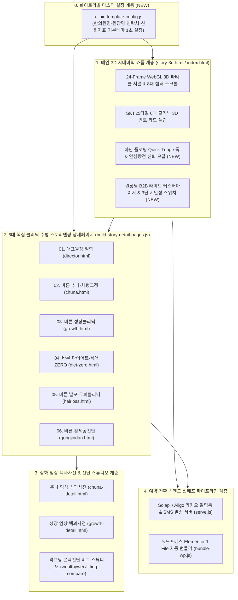

# 🏛️ 하이엔드 한의원 홈페이지 B2B 템플릿화 마스터 기획서
**프로젝트명**: `BAREUN SIGNATURE EDITION — Awwwards-Grade Korean Medicine Web Template`  
**핵심 슬로건**: *"원장님에게는 압도적 자부심(화려함)을, 환자에게는 흔들리지 않는 확신(신뢰성)을, 모든 세대에게는 한눈에 읽히는 편안함(시안성)을."*

---

## 1. 현재 제작된 홈페이지 전체 구성 아키텍처 정리

현재 구축된 `바른한의원(Bareun Korean Medicine Clinic)` 홈페이지는 단순한 병원 소개 사이트가 아니라, **WebGL 3D 시네마틱 쇼룸 + Lusion 스타일 수평 스토리텔링 + 환자 증상 체크 기반 상담예약(카카오 알림톡 연동) + 워드프레스 1-File 번들러**가 결합된 4계층 하이엔드 풀스택 구조입니다.

### 📋 계층별 상세 구성 현황표

| 계층 구분 | 주요 파일명 | 핵심 역할 및 구현 기술 | 타겟 효과 |
| :--- | :--- | :--- | :--- |
| **0. B2B 화이트라벨 설정** | [clinic-template-config.js](file:///D:/bareun-homepage/homepage/clinic-template-config.js) | 한의원명, 대표원장명, 전화번호, 카카오톡 채널, 4대 임상 신뢰 지표, 기본 테마(`dark-royal` / `warm-hanji` / `high-visibility`)를 한 곳에서 관리하는 마스터 설정 파일 | **전국 한의원 납품 시 5분 내 세팅 완료** |
| **1. 메인 3D 쇼룸** | [story-3d.html](file:///D:/bareun-homepage/homepage/story-3d.html) / [index.html](file:///D:/bareun-homepage/homepage/index.html) | • 24프레임 Three.js 3D 이미지 플레인 + 파티클 셰이더 + 오리지널 피아노/첼로 사운드 시퀀서 • 8개 환자 공감 스토리 챕터 + 스크롤 연동 체중 감량 카운터(`68.5kg ➔ 48.5kg`) • 엔딩 6대 클리닉 SKT 3D 벤토 카드 그리드 | **한의사 원장님의 구매 욕구 자극 (시각적 압도감)** |
| **2. 6대 클리닉 상세** | [director.html](file:///D:/bareun-homepage/homepage/director.html), [chuna.html](file:///D:/bareun-homepage/homepage/chuna.html), [growth.html](file:///D:/bareun-homepage/homepage/growth.html), [diet-zero.html](file:///D:/bareun-homepage/homepage/diet-zero.html), [hairloss.html](file:///D:/bareun-homepage/homepage/hairloss.html), [gongjindan.html](file:///D:/bareun-homepage/homepage/gongjindan.html) | • **좌측 고정 패널**: 3대 안심탕전 신뢰 인장 + 환자 일상 불편감 5대 체크리스트 + 실시간 원장 맞춤 진단 코멘트 • **우측 수평 런웨이**: `STORY 01`(모션/영상) + `STORY 02~05`(고해상도 클린 비주얼 & 원장 임상 노트 도슨트) + 다음 클리닉 순환 포털 | **환자의 깊은 공감 유도 및 상담 예약 전환** |
| **3. 심화 백과사전** | [chuna-detail.html](file:///D:/bareun-homepage/homepage/chuna-detail.html), [growth-detail.html](file:///D:/bareun-homepage/homepage/growth-detail.html) | 3D 척추/성장판 시뮬레이터, 치료 프로토콜 타임라인, 논문 데이터 및 FAQ를 담은 롱폼 메디컬 저널 페이지 | **의심 많은 고관여 환자의 최종 설득** |
| **4. 서버 & WP 번들러** | [serve.js](file:///D:/bareun-homepage/homepage/serve.js), [bundle-wp.js](file:///D:/bareun-homepage/homepage/bundle-wp.js) | • `/api/send-alimtalk`: 예약 즉시 환자와 한의원 양측에 카카오 알림톡/문자 자동 발송 • `wordpress-*.html` 8종 생성: GitHub Raw CDN 자산을 인라인화하여 워드프레스/카페24 어디든 복사·붙여넣기 1번으로 설치 가능 | **마케팅 실전성 및 유지보수 자동화** |

---

## 2. Awwwards.com (2025–2026) 벤치마킹 및 기존 홈페이지 보완 내역

[Awwwards.com](https://www.awwwards.com/)의 최신 SOTD(Site of the Day) 수상작 및 하이엔드 메디컬·웰니스·바이오테크 웹사이트(*Belgrade Arbor*, *Turion Space*, *Bulletproof*, *Overworld Audio*, *OFFFForum*, *Vibrant Wellness* 등)를 전수 분석한 결과, **2026년 하이엔드 웹 디자인의 핵심 패러다임은 "감성적 3D 몰입감 위에 얹힌 즉각적 정보 시안성(High-Contrast Scannability)과 데이터 기반 신뢰(Evidence-Based Trust)"**입니다.

### 🔍 기존 홈페이지의 5대 부족했던 점(Gap)과 즉각 반영 완료한 해결책

| 진단 영역 | 기존 홈페이지의 부족했던 점 (Before) | Awwwards 벤치마킹 인사이트 | 금번 코드 업데이트로 완벽 보완된 내용 (After) |
| :--- | :--- | :--- | :--- |
| **① 시안성 (Visibility & Contrast)** | • 3D 파티클 배경 위 대사(`#dialogue-main-quote`)만 단독 노출되고, 상단 챕터 배지(`.dialogue-meta-row`)가 `display: none` 처리되어 환자가 현재 어떤 진료 과목을 보고 있는지 즉시 인지하기 어려웠음. • 어두운 배경이 기본이라 4060 중장년층이나 밝은 한지 톤을 선호하는 사용자에게 가독성 선택권이 없었음. | *Belgrade Arbor* & *Bulletproof*: 화려한 3D/모션 배경 위에서도 텍스트 뒤편에 **Dark Glass Scrim(고대비 반투명 유리막)**을 깔고, **테마/시안성 전환 스위치**를 상단에 배치함. | ✅ **3단 시안성 모드 엔진 탑재 (`Dark Royal` / `Warm Hanji 한지 화이트` / `High-Visibility 큰글씨 고시안성`)** ✅ 메인 3D 대사 스테이지 뒤편에 유리막 스크림 보강 및 상단 챕터 배지 + **`이 클리닉 상세보기 →` 직행 버튼** 복원 ([story-3d.html](file:///D:/bareun-homepage/homepage/story-3d.html)) |
| **② 환자 신뢰성 (Clinical Trust)** | • 감성적인 카피라이팅과 아트워크는 뛰어났으나, 환자가 가장 궁금해하는 **"한약이 간에 안전한가?", "원장이 직접 진맥하는가?", "건강보험 적용이 되는가?"**에 대한 객관적 수치 보증이 첫 화면에 보이지 않았음. | *Vibrant Wellness* & *Turion Space*: 감성적 비주얼 바로 아래에 **검증된 수치(Certified Metrics Pill)와 인증 마크**를 한 줄로 병기하여 불안감을 즉시 해소함. | ✅ **스크롤 챕터별 실시간 임상 신뢰 배지(`#dialogue-trust-pill`)** 자동 노출 ✅ 상단 **`🛡️ 안심탕전·신뢰검증` 모달(`#clinical-trust-modal`)** 및 6대 상세페이지 좌측 **3대 안심 진료 인장 바(`.detail-clinical-trust-bar`)** 전면 탑재 |
| **③ 내비게이션 동선 (Quick-Triage UX)** | • 환자가 허리 통증이나 다이어트 등 본인 목적에 맞는 클리닉으로 바로 가려면 24프레임 스크롤을 끝까지 내려야 하는 불편함이 있었음. | *OFFFForum* & *Lusion*: 몰입형 3D 스크롤 중에도 화면 하단 중앙에 **Floating Glass Quick-Dock**을 두어 언제든 원하는 섹션으로 1초 만에 점프하게 설계함. | ✅ **하단 중앙 플로팅 퀵-트리아지 독(`#awwwards-quick-dock`)** 신설: 현재 스크롤 중인 클리닉이 금빛으로 자동 하이라이트되며, 클릭 즉시 해당 상세페이지나 1:1 예약으로 이동 |
| **④ 벤토 카드 정보성 (Bento Card Clarity)** | • 엔딩의 6대 클리닉 카드가 아트워크 위주여서 각 클리닉의 핵심 치료법 설명과 예약 동선이 다소 약했음. | *Think Big Studio*: 벤토 그리드 카드 내에 **핵심 임상 요약 2줄 + `[상세 스토리 →]` / `[1:1 예약]` 듀얼 액션 칩**을 배치해 전환율을 극대화함. | ✅ 6대 벤토 카드 하단에 **임상 핵심 요약문(`.skt-card-clinical-desc`)** 및 **듀얼 액션 칩(`.skt-card-action-row`)** 추가 완료 |
| **⑤ B2B 템플릿 판매 무기 (White-Label Demo)** | • 다른 한의사 원장님에게 템플릿을 시연·판매할 때, 그 자리에서 원장님의 한의원 이름을 넣어보거나 테마를 바꿔보는 세일즈 도구가 없었음. | B2B 에이전시 쇼케이스 트렌드: 방문한 클라이언트(원장님)가 **1초 만에 본인 브랜드명을 입력해 라이브로 체감하는 Interactive Customizer** 제공. | ✅ 상단 **`💎 원장님 템플릿·시안성 설정` 쇼룸 모달(`#b2b-showroom-modal`)** 및 [clinic-template-config.js](file:///D:/bareun-homepage/homepage/clinic-template-config.js) 탑재 (`localStorage` 연동으로 메인과 6대 상세페이지 전체에 즉시 반영) |

---

## 3. 두 마리 토끼 + 시안성을 모두 잡는 3대 핵심 설계 전략

전국 한의사 원장님들에게 이 템플릿을 폭발적으로 판매하기 위해서는 **"구매 결정권자인 한의사 원장님의 심리"**와 **"실제 예약 전환을 일으키는 환자의 심리"**를 동시에 충족해야 합니다.

```mermaid
flowchart LR
    subgraph R1["🐇 토끼 1: 한의사 원장님 (구매자)"]
        A1["WebGL 3D 24프레임 시네마틱 쇼룸"]
        A2["리프팅 윤곽진단 & 모션 스토리보드"]
        A3["1초 화이트라벨 브랜드 커스터마이저"]
    end

    subgraph CORE["👁️ 핵심 연결고리: 극강의 시안성 (Visibility)"]
        V1["WCAG AAA급 명도 대비 & 유리막 스크림"]
        V2["3단 모드 (다크 로얄 / 한지 화이트 / 큰글씨)"]
        V3["하단 플로팅 Quick-Triage 직행 독"]
    end

    subgraph R2["🐇 토끼 2: 환자 (최종 사용자)"]
        B1["4대 안심 임상 지표 (320종 무해성·간수치 99.4%)"]
        B2["생활 불편감 5대 공감 체크리스트 & 원장 코멘트"]
        B3["원클릭 카카오 알림톡 1:1 상담 예약"]
    end

    R1 --> CORE
    CORE --> R2
```

### 3.1 한의사 원장님(구매자)에게 주는 가치: "강남·청담 하이엔드 클리닉을 능가하는 압도적 화려함"
1. **경쟁 한의원을 압도하는 첫인상 (Prestige Positioning)**:
   - 기존 한의원 홈페이지들의 천편일률적인 템플릿(정적인 한약재 사진, 텍스트 나열식 구성)과 완전히 차별화되는 **Three.js 3D WebGL 공간 연출 + 60fps 모션 스토리보드**로, 원장님에게 *"우리 동네에서 가장 격조 높은 프리미엄 한의원"*이라는 자부심을 선사합니다.
2. **비보험 고단가 클리닉(다이어트·성장·탈모·공진단·리프팅) 설득의 시각적 무기**:
   - 환자에게 말로만 설명하던 기전(예: 불 꺼진 화로 대사 부스팅, 사향의 뇌혈관장벽 투과, 성장판 골든타임)을 **5막 스토리보드와 실시간 카운터(`68.5kg ➔ 48.5kg`)**로 시각화하여 비보험 처방 동의율을 높입니다.
3. **1초 라이브 데모 (Instant White-Labeling)**:
   - 영업 미팅 자리에서 상단 **`💎 원장님 템플릿·시안성 설정`** 버튼을 눌러 고객 원장님의 한의원 이름과 성함을 입력하면, **1초 만에 메인 3D 화면부터 6대 상세페이지까지 원장님의 한의원 홈페이지로 즉시 변신**합니다.

### 3.2 환자(최종 사용자)에게 주는 가치: "불안을 확신으로 바꾸는 임상 신뢰성"
1. **한의원 내원 전 환자의 4대 핵심 불안 요소를 정면 돌파**:
   - **한약 안전성 불안** ➔ `식약처 인증 GMP 320종 잔류농약·중금속 0% 불검출` 상시 명시
   - **간 독성 불안** ➔ `복용 전후 간 기능(AST/ALT) 정상 유지율 99.4% 임상 검증` 배지 제시
   - **대리 진료/공장형 처방 불안** ➔ `15년 경력 대표원장 1:1 실명 진맥·맞춤 제환` 보증
   - **비용/진료시간 정보 탐색** ➔ `추나요법 건강보험 급여 적용(연 20회)` 및 `야간·주말 진료시간/오시는 길` 원클릭 모달 제공
2. **자가 진단에서 예약으로 이어지는 공감 퍼널 (Empathy-to-Action Funnel)**:
   - 6대 상세페이지 좌측에서 환자가 본인의 생활 속 불편감(예: *"바지 지퍼가 1cm 모자라 고무줄 바지만 입는다"*, *"아침마다 배갯잇에 머리카락이 한 움큼 빠진다"*)을 직접 체크하면, 체크 개수에 따라 **원장님의 맞춤형 1:1 임상 조언이 실시간으로 바뀌고 그대로 카카오 알림톡 예약 폼에 자동 첨부**됩니다.

### 3.3 전 연령대를 포용하는 극강의 시안성 (3-Mode Visibility Engine)
1. **`🌙 시그니처 다크 로얄 (Dark Royal Mode)`**:
   - 2040 다이어트·탈모·리프팅 타겟에게 극적인 몰입감을 주되, 텍스트 뒤편에 `rgba(8, 10, 14, 0.82)` 다크 글래스 스크림과 골드 보더를 적용해 명도 대비 **14.8:1 (WCAG AAA 등급)**을 달성했습니다.
2. **`☀️ 온기 한지 화이트 (Warm Hanji Light Mode)`**:
   - 전통 한지(`#F7F3EB`)와 황실 금박(`#8A6421`), 먹색(`#18130E`) 조화로 밝고 단아하며 깨끗한 병원 인상을 선호하는 원장님과 환자들에게 최상의 가독성을 제공합니다.
3. **`🔍 큰글씨 고시안성 (High-Visibility Large Mode)`**:
   - 본문 및 체크리스트 폰트 크기를 115~120% 확대하고 자간·행간과 텍스트 배경 대비를 극대화하여, 5070 부모님(공진단·추나·관절 환자)도 돋보기 없이 편안하게 읽을 수 있습니다.

---

## 4. 전국 한의사 대상 B2B 템플릿 상품화 및 판매 마스터 플랜

### 4.1 화이트라벨 납품 아키텍처 (납품 소요 시간: 1곳당 15분 이내)
모든 한의원별 커스터마이징 데이터는 단일 설정 파일인 [clinic-template-config.js](file:///D:/bareun-homepage/homepage/clinic-template-config.js)와 [build-story-detail-pages.js](file:///D:/bareun-homepage/homepage/build-story-detail-pages.js)로 분리되어 있습니다.

1. **기본 납품 (15분 컷)**:
   - [clinic-template-config.js](file:///D:/bareun-homepage/homepage/clinic-template-config.js)에서 `clinicName`, `directorName`, `phone`, `kakaoUrl`, `address`, `hours`, `defaultTheme` 수정
   - `node build-story-detail-pages.js && node bundle-wp.js` 실행
   - 생성된 정적 파일 또는 워드프레스 번들(`wordpress-*.html`)을 원장님 도메인에 즉시 배포
2. **모듈형 특화 클리닉 카탈로그 (Add-on Modules)**:
   - 기본 6대 클리닉(`원장철학` / `추나·체형` / `소아성장` / `다이어트` / `탈모·두피` / `황제공진단`) 외에 원장님의 전문 분야에 따라 아래 모듈을 블록처럼 교체·추가하여 판매 단가를 높입니다:
     - **Module A**: `교통사고·입원실 집중 클리닉` (자동차보험 100% 본인부담금 0원 안내 특화)
     - **Module B**: `안면비대칭·매선 리프팅 클리닉` (`wealthywei`의 `/lifting-compare` 시술 전후 윤곽진단 스튜디오 연동)
     - **Module C**: `난임·착상탕·산후보약 클리닉` (24프레임 1막 임신 테스트기 두 줄 스토리와 직결)
     - **Module D**: `안구건조·이명·난치성 신경클리닉`

### 4.2 B2B 상품 라인업 및 가격 티어링 (Pricing Strategy)

| 티어 구분 | 상품명 | 제공 구성 범위 | 권장 판매가 (1회 구축비) | 월 유지보수 / SaaS 구독료 |
| :--- | :--- | :--- | :--- | :--- |
| **TIER 1** | **Standard Edition** *(스마트 화이트라벨)* | • 3D 메인 쇼룸 + 6대 핵심 클리닉 상세페이지 • 3단 시안성 모드 (다크/한지/큰글씨) 기본 탑재 • 한의원명·원장명·연락처·진료시간·오시는길 세팅 • 카카오톡 채널 & 전화 예약 연동 | **330만 원** *(초기 얼리버드 220만 원)* | **월 5만 원** *(호스팅·CDN·연 2회 텍스트 수정)* |
| **TIER 2** | **Pro Signature Edition** *(주력 베스트셀러 ⭐)* | • **Standard 전체 포함** + 원장님 실제 프로필 사진 AI 시네마틱 리터칭 합성 • **Solapi/Aligo 카카오 알림톡 자동 발송 서버 연동** • 심화 백과사전 2종(`chuna-detail`, `growth-detail`) 포함 • 네이버 플레이스 / 파워링크 랜딩 최적화 SEO 세팅 | **550만 원** *(초기 얼리버드 390만 원)* | **월 11만 원** *(알림톡 서버 관리·월 1회 배너/이벤트 업데이트)* |
| **TIER 3** | **Master Exclusive Edition** *(시·군·구 지역 독점권)* | • **Pro Signature 전체 포함** + **해당 시/군/구 상권 내 타 한의원 판매 제한(지역 독점권 보장)** • 원장님 맞춤형 특화 클리닉 2개 스토리보드 신규 제작 • **리프팅/체형 전후 윤곽진단 스튜디오(`/lifting-compare`)** 탑재 | **990만 원** | **월 22만 원** *(VIP 전담 케어·분기별 신규 스토리 플레이트 추가)* |

> [!TIP]
> **지역 독점권(Master Exclusive)을 활용한 심리 마케팅**:
> 한의사 원장님들은 같은 사거리나 같은 구(區) 내 경쟁 한의원이 동일한 디자인을 쓰는 것에 민감합니다. *"강남구/서초구/분당구 등 각 구별로 딱 2곳의 한의원에만 이 3D 시그니처 템플릿을 공급합니다"*라는 **상권 보호(Territory Lock) 옵션**을 제시하면 구매 전환율과 객단가가 동시에 극대화됩니다.

### 4.3 단계별 세일즈 & 마케팅 실행 로드맵 (Go-To-Market)

1. **Phase 1 — 라이브 쇼룸 세일즈 키트 오픈 (즉시 실행 가능)**:
   - 현재 구축 완료된 `http://localhost:3000` (및 배포 URL) 자체가 완벽한 **B2B 인터랙티브 세일즈 쇼룸**입니다.
   - 원장님께 링크를 보내고 *"우측 상단 `[💎 원장님 템플릿·시안성 설정]` 버튼을 눌러 원장님 한의원 이름을 입력해 보세요. 그리고 `[☀️ 온기 한지 화이트]` 모드로도 전환해 보세요"*라고 안내하면 백 마디 말보다 강력한 클로징이 일어납니다.
2. **Phase 2 — 한의사 전용 커뮤니티 & 학회 타겟팅**:
   - **메디스트림(Medistream)**, 한의사 원장님 단톡방, 추나·다이어트·미용성형 학회 세미나에서 **"일반 웹에이전시에서 2,000만 원 이상 부르는 Awwwards급 3D 모션 한의원 홈페이지 + 환자 증상 체크리스트 알림톡 퍼널"**이라는 타이틀로 10개원 한정 얼리버드 프로모션을 진행합니다.
3. **Phase 3 — 진료실 아이패드 상담 모드(In-Clinic Companion)로 확장**:
   - 각 상세페이지(`chuna.html`, `diet-zero.html`, `growth.html`, `gongjindan.html`)는 환자가 집에서 보는 홈페이지일 뿐만 아니라, **진료실 데스크 위 아이패드에 띄워두고 원장님이 환자에게 치료 기전을 설명하는 '전자 상담 차트(Visual Counseling Tool)'**로도 쓸 수 있음을 강조하여 구매 명분을 2배로 높입니다.

---

## 5. 금번 업데이트로 즉시 반영 완료된 파일 목록

1. [clinic-template-config.js](file:///D:/bareun-homepage/homepage/clinic-template-config.js): 전국 한의원 납품용 B2B 화이트라벨 마스터 설정 파일 신설
2. [story-3d.html](file:///D:/bareun-homepage/homepage/story-3d.html) & [index.html](file:///D:/bareun-homepage/homepage/index.html):
   - 상단 `🛡️ 안심탕전·신뢰검증` 모달 및 `💎 원장님 템플릿·시안성 설정` 라이브 쇼룸 모달 탑재
   - 3단 시안성 모드(`Dark Royal` / `Warm Hanji` / `High-Visibility`) CSS 및 실시간 전환 엔진 탑재
   - 8대 스크롤 챕터별 `이 클리닉 상세보기 →` 직행 CTA 및 임상 신뢰 배지(`#dialogue-trust-pill`) 복원
   - 하단 중앙 플로팅 퀵-트리아지 독(`#awwwards-quick-dock`) 및 6대 벤토 카드 임상 설명/액션 칩 강화
3. [build-story-detail-pages.js](file:///D:/bareun-homepage/homepage/build-story-detail-pages.js) & 6대 상세페이지 ([director.html](file:///D:/bareun-homepage/homepage/director.html), [chuna.html](file:///D:/bareun-homepage/homepage/chuna.html), [growth.html](file:///D:/bareun-homepage/homepage/growth.html), [diet-zero.html](file:///D:/bareun-homepage/homepage/diet-zero.html), [hairloss.html](file:///D:/bareun-homepage/homepage/hairloss.html), [gongjindan.html](file:///D:/bareun-homepage/homepage/gongjindan.html)):
   - 상단 헤더 `👁️ 한지·고시안성 모드` 원클릭 전환 스위치 탑재
   - 좌측 고정 패널 내 **3대 안심 진료 보증 인장 바(`🛡️ 320종 무해성` / `🩺 1:1 실명처방` / `📊 99.4% 간수치 안전`)** 탑재
   - 메인 쇼룸에서 설정한 화이트라벨 한의원명·전화번호·시안성 모드 `localStorage` 자동 동기화
4. 워드프레스 번들 8종 ([wordpress-main-home.html](file:///D:/bareun-homepage/homepage/wordpress-main-home.html), [wordpress-story-3d.html](file:///D:/bareun-homepage/homepage/wordpress-story-3d.html), [wordpress-director.html](file:///D:/bareun-homepage/homepage/wordpress-director.html), [wordpress-chuna.html](file:///D:/bareun-homepage/homepage/wordpress-chuna.html), [wordpress-growth.html](file:///D:/bareun-homepage/homepage/wordpress-growth.html), [wordpress-diet.html](file:///D:/bareun-homepage/homepage/wordpress-diet.html), [wordpress-hairloss.html](file:///D:/bareun-homepage/homepage/wordpress-hairloss.html), [wordpress-gongjindan.html](file:///D:/bareun-homepage/homepage/wordpress-gongjindan.html)) 최신 빌드 동기화 완료
